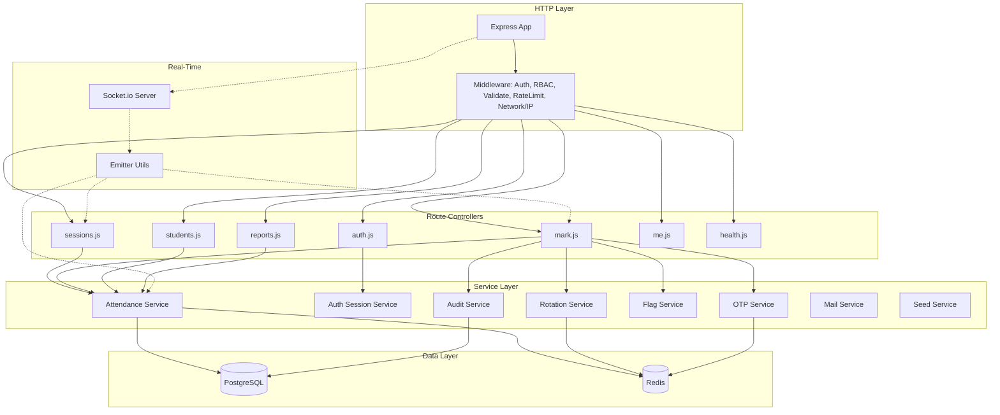
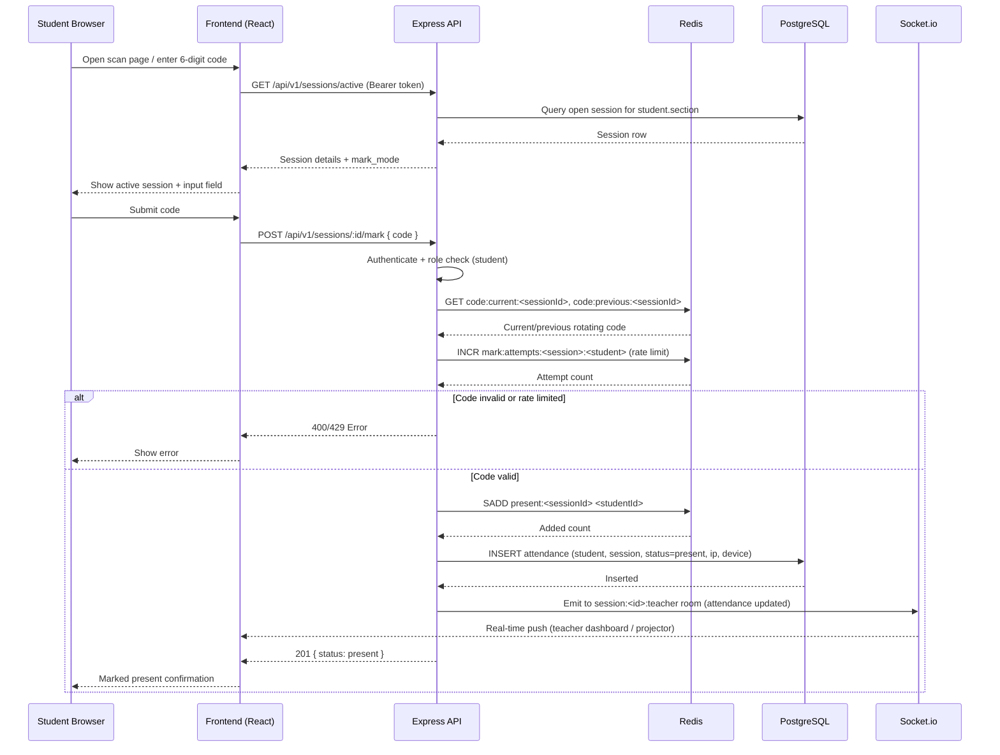
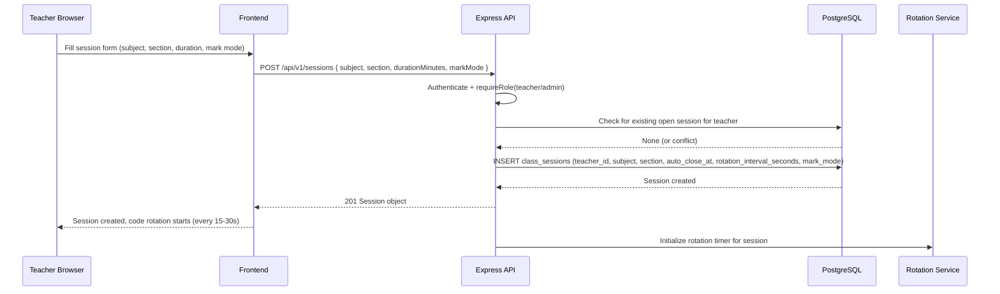
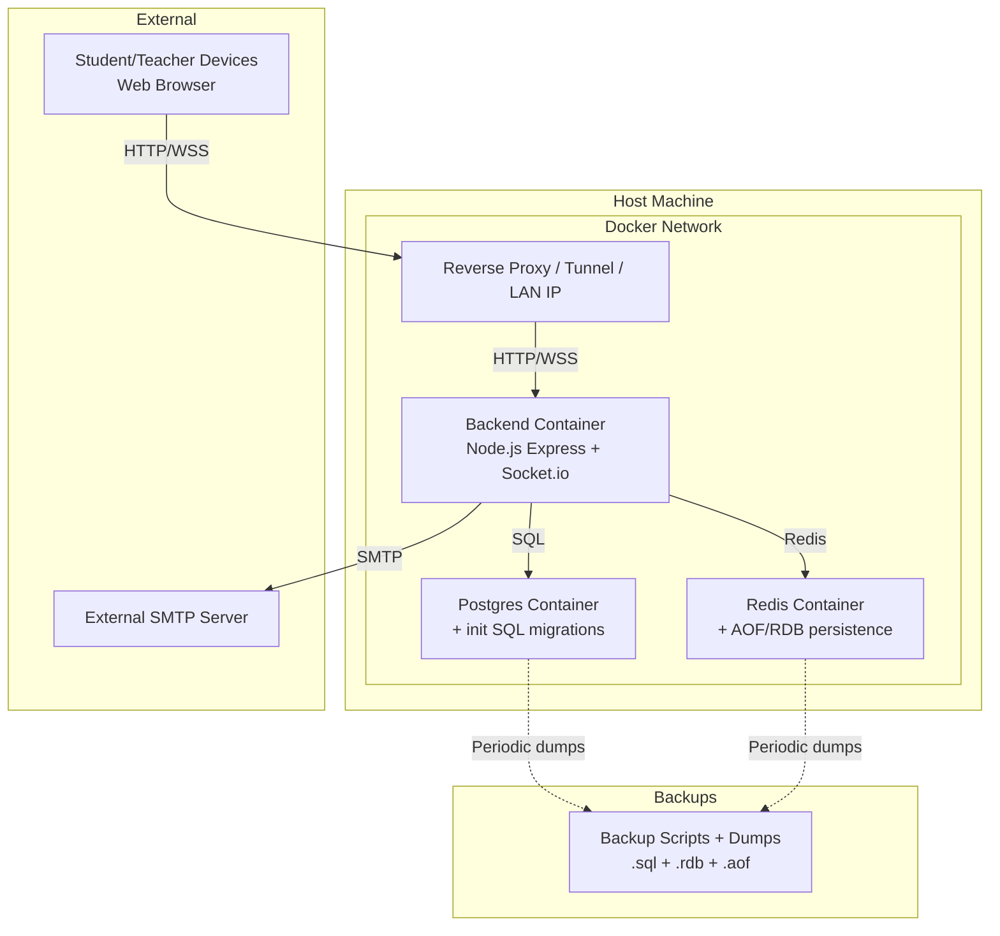

# Attendance Marking — High Level Design (HLD)

## 1. Overview

The **Attendance Marking** system is a full-stack classroom attendance application. Teachers create timed sessions with rotating verification codes; students mark themselves present via a 6-digit code or QR scan (subject to network/device restrictions); real-time dashboards and projector screens display live attendance.

- **Frontend:** React + Vite SPA
- **Backend:** Node.js + Express REST API + Socket.io server
- **Database:** PostgreSQL (primary), Redis (caching, rate limits, rotating codes, present-sets)
- **Email:** SMTP via Nodemailer (OTP delivery)
- **Containerization:** Docker / Docker Compose

---

## 2. Container-Level Diagram

```mermaid
C4Container
    title System Container Diagram - Attendance Marking

    Person(student, "Student", "Marks attendance via code/QR")
    Person(teacher, "Teacher", "Creates sessions, manages roster, views reports")
    Person(admin, "Admin", "System oversight, reports, user management")

    System_Boundary(c1, "Attendance App") {
        Container(frontend, "Frontend (React + Vite)", "JavaScript/React", "SPA - login, dashboards, scanner, projector screen")
        Container(backend, "Backend API (Node + Express)", "JavaScript", "REST API, auth, business logic, Socket.io server")
        ContainerDb(postgres, "PostgreSQL", "Relational DB", "Users, sessions, attendance, audit log")
        ContainerDb(redis, "Redis", "In-memory store", "Rotating codes, present-sets, rate limits, OTP state")
        Container(smtp, "SMTP Server", "Email", "OTP delivery via Nodemailer")
    }

    BiDir(student, frontend, "Uses", "HTTPS/WSS")
    BiDir(teacher, frontend, "Uses", "HTTPS/WSS")
    BiDir(admin, frontend, "Uses", "HTTPS/WSS")

    Rel(frontend, backend, "API calls (REST) + Socket.io events", "HTTP/JSON, WebSocket")
    Rel(backend, postgres, "Queries", "SQL (pg)")
    Rel(backend, redis, "Cache / pub-sub / state", "Redis (ioredis)")
    Rel(backend, smtp, "Sends OTP email", "SMTP")

    Rel_Neighbor(frontend, postgres, "No direct access", "None")
    Rel_Neighbor(frontend, redis, "No direct access", "None")
```

---

## 3. Backend Component Diagram



---

## 4. Sequence Diagram — Student Marks Attendance



---

## 5. Sequence Diagram — Teacher Creates Session



---

## 6. Deployment View (Docker Compose)



---

## 7. ASCII Architecture Overview

```
+---------------------+      HTTPS/WSS      +-----------------------------+
|   Client Devices    | <==================> |   Load Balancer / LAN IP   |
| (Student/Teacher)   |      (React SPA)     |   (optional tunnel/proxy)  |
+---------------------+                      +-----------------------------+
                                                         |
                                                         | HTTP/JSON + WS
                                                         v
                                               +-----------------------------+
                                               |   Backend (Node/Express)    |
                                               |  - Auth middleware          |
                                               |  - Route controllers        |
                                               |  - Socket.io server         |
                                               +-----------------------------+
                                                         |
          +------------------------------------------------+------------------------------------------------+
          | SQL (pg)                                       | Redis (ioredis)                               |
          v                                                v                                               v
   +--------------+                                +------------------+                           +--------------+
   | PostgreSQL   |                                | Rotating codes   |                           | Present sets |
   | - users      |                                | (current/prev)   |                           | (per session)|
   | - sessions   |                                | Rate-limit cnts  |                           | Rate-limit TT|
   | - attendance |                                | OTP state        |                           +--------------+
   | - audit_log  |                                +------------------+
   +--------------+
          |
          | SMTP
          v
   +--------------+
   | SMTP Server  |  (OTP delivery)
   +--------------+
```

---

## 8. Data Model (PostgreSQL)

| Table | Purpose | Key Fields |
|-------|---------|------------|
| `users` | Students, teachers, admins | `id`, `email`, `name`, `role` (enum), `roll_number`, `section`, `bound_device_id`, `is_active` |
| `class_sessions` | Open class session owned by a teacher | `id`, `teacher_id`, `subject`, `section`, `status` (open/closed), `auto_close_at`, `rotation_interval_seconds`, `rotation_paused`, `mark_mode` |
| `attendance` | One record per student per session | `id`, `session_id`, `student_id`, `status` (present/absent/excused), `marked_at`, `marked_by`, `ip_address`, `device_id`, `code_window`, `note` |
| `audit_log` | Immutable action log | `id`, `actor_id`, `action`, `session_id`, `ip_address`, `device_id`, `meta` (jsonb), `created_at` |

**Constraints:**
- One open session per teacher (unique partial index on `teacher_id WHERE status = 'open'`)
- One attendance record per student per session (`UNIQUE(session_id, student_id)`)

---

## 9. Key Features

### Session Lifecycle (Teacher)
- Create session with subject, section, duration, rotation interval, mark mode (`code` or `qr`)
- Only one open session per teacher at a time
- Auto-close after configured duration
- Pause/resume code rotation, force-rotate now, close early
- `recoverOpenSessions()` rehydrates open sessions after server restart

### Attendance Marking (Student)
- View active session filtered by student's section
- Submit 6-digit rotating code (Redis stores `current` + `previous` for clock-skew tolerance)
- IP subnet allowlist (`ALLOWED_SUBNETS`) and optional device binding (`bound_device_id`)
- Rate-limited: max 5 mark attempts per minute per session+student
- Result written to Redis set `present:<sessionId>` and PostgreSQL
- Real-time Socket.io push to teacher/projector rooms

### Mark Modes
- `code`: Student types a rotating 6-digit code
- `qr`: QR-based marking (frontend `QrScanner` component)

### Roster Management (Teacher/Admin)
- CRUD for students
- Bulk import via CSV/Excel upload

### Reports
- Per-student attendance history with attended/total/percentage
- Summary report with filters (section, subject, date range)
- CSV export

### Real-Time (Socket.io)
- Authenticated WebSocket connections
- Rooms: `role:<role>`, `session:<id>`, `session:<id>:teacher`
- Live attendance updates pushed to dashboards and projector screens

### Security & Observability
- JWT/session token via `Authorization: Bearer` or HTTP-only cookie
- Role-based access control (`student`, `teacher`, `admin`)
- Helmet security headers, CORS-aware static serving
- OTP step-up authentication (optional)
- Audit logging for sensitive actions
- Rate limiting on OTP requests and mark attempts

---

## 10. Project Structure

```
attendence-marking/
├── backend/
│   └── src/
│       ├── index.js            # Express app entry + server boot
│       ├── config.js           # Environment configuration
│       ├── db/                 # PostgreSQL pool + migrations
│       ├── middleware/         # Auth, RBAC, validation, rate limit, IP, errors
│       ├── routes/             # auth, sessions, mark, students, me, reports, health
│       ├── services/           # attendance, authSession, otp, rotation, flags, audit, mail, seed
│       ├── sockets/            # Socket.io setup + emitter utilities
│       └── utils/              # error helpers, IP helpers
├── frontend/
│   └── src/
│       ├── api.js, auth.jsx, socket.js
│       ├── App.jsx, main.jsx
│       ├── pages/              # Login, StudentHome, TeacherDashboard, History, ScanPage, ProjectorScreen
│       └── components/         # QrScanner, LiveSession, ReportsPanel, RosterManager, SessionsList
├── CY-AIC / CY-AIMLC/          # Excel/CSV to JSON import utilities
├── docker-compose.yml, Dockerfile
├── .env, .env.example
├── Attendance App API Specification.md
├── Attendance App Plan Update with Redis.md
└── HLD.md                      # This document
```

---

## 11. Key Design Decisions

| Concern | Decision |
|---------|----------|
| **Auth** | JWT/session token via `Authorization: Bearer` or HTTP-only cookie (`session`) |
| **Roles** | `student`, `teacher`, `admin` enforced via route middleware |
| **Real-time** | Socket.io rooms: `role:<role>`, `session:<id>`, `session:<id>:teacher` |
| **Code rotation** | Redis stores current + previous 6-digit code; rotates every 15–30s |
| **Deduplication** | Redis `SADD present:<sessionId>` + Postgres `UNIQUE(session_id, student_id)` |
| **Security** | IP subnet allowlist, optional device binding, OTP step-up, audit logging |
| **Recovery** | `recoverOpenSessions()` rehydrates open sessions after restart |
| **Backend framework** | Express (REST) + Socket.io (WebSockets) |
| **Database** | PostgreSQL (primary), Redis (state/cache) |